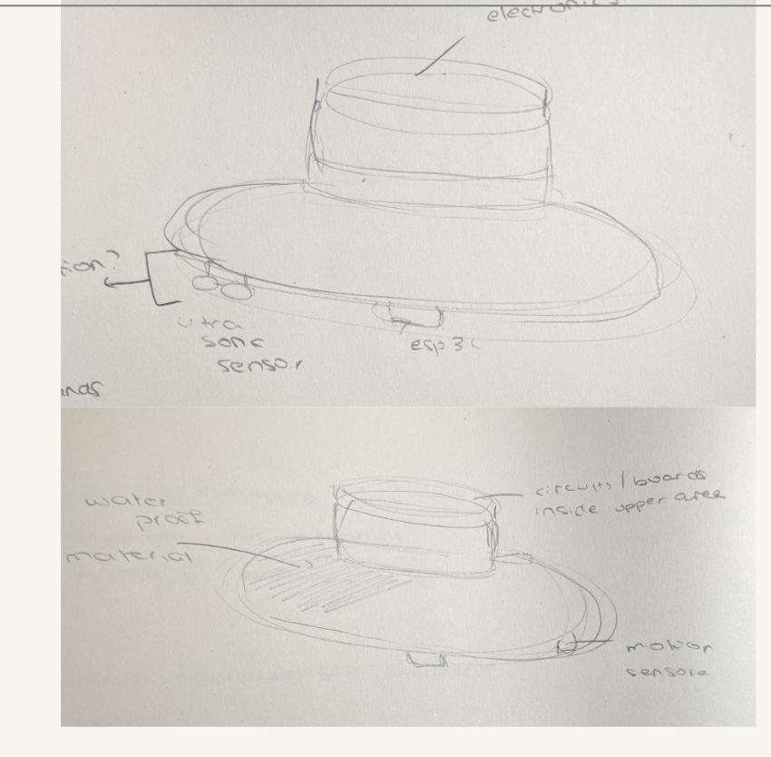
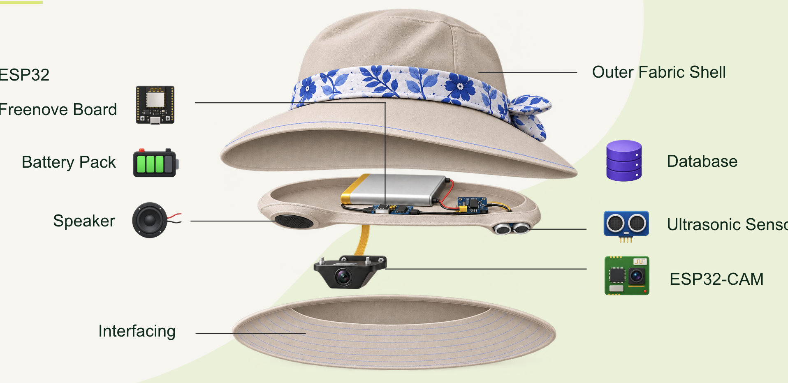
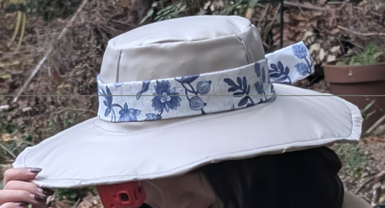

# Plant Health Hat

A wearable hat that identifies plant diseases out loud. Walk up to a plant, the hat detects proximity, takes a photo, runs two CNN classifiers, asks Claude AI for a diagnosis, and speaks the result through a built-in speaker — hands-free.

Built for people who have difficulty visually identifying plants or spotting early signs of disease.

---

## The hat

**Concept sketches** — electronics in the upper band, ultrasonic sensor and ESP32 under the brim.



**Exploded view** — how the components fit together inside.



**Prototype** — the finished hat being worn.



---

## Hardware

| Component | Purpose |
|---|---|
| ESP32 (Freenove) | Ultrasonic sensing + I2S audio + WiFi |
| HC-SR04 | Proximity trigger (Trig → GPIO 5, Echo → GPIO 18) |
| MAX98357A + speaker | I2S Class-D amplifier (BCLK → 27, LRC → 14, DIN → 26) |
| ESP32-CAM (AI-Thinker) | Photo capture over WiFi |
| Battery pack | Powers the hat untethered |

---

## Software

```
computer/
├── server.py              FastAPI server — pipeline coordinator
├── hat.py                 Sensor thread, TTS, WiFi speaker, pipeline logic
├── classifier.py          Pumpkin CNN (MobileNetV2, 5 classes, HuggingFace)
├── classifier_plantvillage.py  PlantVillage CNN (Keras .h5, 15 classes)
├── explainer.py           Claude claude-opus-5-5 vision — plain-language diagnosis
├── webcam.py              Laptop webcam fallback for the dashboard
├── speak_serial.py        CLI tool: send speech to ESP32 over USB serial
├── train.py               Fine-tune MobileNetV2 on pumpkin leaf data
├── get_model.py           Download the pumpkin model from HuggingFace
├── get_pumpkin_data.py    Download the pumpkin training dataset
├── static/hat.html        Live dashboard (SSE, camera, Say anything, volume)
└── requirements.txt

esp32/
├── hat_sensor/            ESP32: ultrasonic + I2S speaker + WiFi + OTA
└── hat_cam/               ESP32-CAM: camera + distance sensor + WiFi + OTA
```

---

## Network architecture

All devices connect to the **same WiFi** (e.g. iPhone hotspot). The laptop runs the server; the ESP32s are HTTP endpoints the server calls.


| Device | mDNS name | What it does |
|---|---|---|
| Laptop :8000 | — | Runs FastAPI, CNNs, Claude AI, TTS |
| Browser | — | Dashboard — SSE feed, controls, camera view |
| ESP32 (Freenove) | `hatsensor.local` | Ultrasonic distance + I2S speaker |
| ESP32-CAM | `hatcam.local` | Photo capture + distance |

---

## How it works

1. Ultrasonic sensor detects a plant closer than ~40 cm
2. ESP32-CAM captures a photo and sends it to the laptop server
3. Two CNNs classify the leaf (pumpkin diseases + 15 PlantVillage classes)
4. Claude AI receives the photo + CNN results and writes a spoken diagnosis
5. Python generates audio with macOS `say` (Samantha voice, 140 wpm)
6. ESP32 downloads the audio file over WiFi and plays it through the speaker

---

## Setup

### Prerequisites

- macOS laptop on the same WiFi hotspot as the ESP32s
- `ANTHROPIC_API_KEY` environment variable set
- Python 3.11+

### Install

```bash
cd computer
python3 -m venv venv
source venv/bin/activate
pip install -r requirements.txt
```

### Download models

```bash
python get_model.py          # downloads pumpkin MobileNetV2
# model_plantvillage.h5 must be placed in computer/ manually
```

### Flash ESP32s

1. Open `esp32/hat_sensor/hat_sensor.ino` in Arduino IDE
2. Create `esp32/hat_sensor/wifi_secrets.h`:
   ```cpp
   #define WIFI_SSID     "your-hotspot"
   #define WIFI_PASSWORD "your-password"
   ```
3. Flash via USB. After first flash, OTA is available at `hatsensor.local`.
4. Repeat for `esp32/hat_cam/` → flashes as `hatcam.local`.

### Run the server

```bash
cd computer
source venv/bin/activate
ANTHROPIC_API_KEY=sk-... python server.py
```

Dashboard: [http://localhost:8000](http://localhost:8000)

---

## Dashboard

- **Monitor** — start/stop proximity detection
- **Camera** — snap a photo or simulate a scan
- **Say anything** — type text and the hat speaks it
- **Volume** — adjust speaker output
- **Tests** — beep the speaker, check classifier status

---

## API

| Endpoint | Method | Description |
|---|---|---|
| `/api/status` | GET | Full system state |
| `/api/analyze` | POST | Run pipeline on an uploaded image |
| `/api/speak` | POST `{"text": "..."}` | Speak text through the hat |
| `/api/tts` | POST `{"text": "..."}` | Generate audio and return a URL |
| `/api/volume` | GET/POST | Read or set volume (0.0–1.0) |
| `/api/events` | GET | SSE stream for live dashboard updates |
| `/records/tts/*.raw` | GET | Served audio files for ESP32 download |
